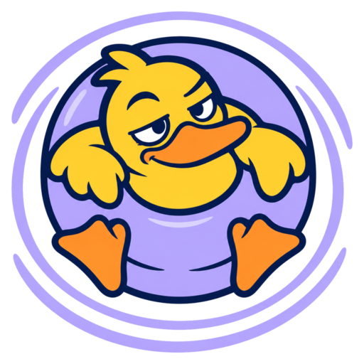

<p align="center">
  
</p>

<h1 align="center">DockPond</h1>

<p align="center">Floating docks for iOS layout work.</p>

DockPond has two libraries:

| Library | Use |
|---|---|
| **FloatingDock** | A floating button that docks to a screen edge and opens a panel. You supply the panel content and its actions. |
| **GaugeDock** | A layout gauge. It measures the window size, the screen, the orientation, the size classes, the safe area, the display scale, and the hinge. It can show the values in a floating dock. |

Requirements: iOS 18 or later, Swift 6. The hinge values need iOS 27.1 or later.

## Install

Add the package to `Package.swift`:

```swift
.package(url: "https://github.com/yyjim/DockPond", from: "0.1.0")
```

Then add the products that you need to your target:

```swift
.product(name: "FloatingDock", package: "DockPond"),
.product(name: "GaugeDock", package: "DockPond"),
```

In Xcode, select **File > Add Package Dependencies**, and enter the repository URL.

## FloatingDock

The dock shows a button in a separate window above the app, also above sheets.

- Drag the button. When you release it, it moves to the nearest screen edge. The dock keeps this position after rotation, a fold, and a new launch.
- After a period without use, the button fades.
- Tap the button to open the panel. Tap outside the panel to close it. The app also receives that tap.
- Tap a panel action to close the panel and run the action.

### SwiftUI

Apply the modifier one time, to the root view of the scene:

```swift
import FloatingDock

WindowGroup {
    RootView()
        .floatingDock(title: "Tools", systemImage: "wrench.and.screwdriver") {
            ToolsView(model: model)
        } actions: {
            Button("Settings", systemImage: "slider.horizontal.3") { showsSettings = true }
        }
}
```

The panel is not in the hierarchy of your view, so it does not get your custom environment values. Give the content an observable model to read.

### UIKit

Create the controller in `scene(_:willConnectTo:options:)`, and keep a strong reference to it:

```swift
import FloatingDock

let dock = FloatingDockController(title: "Tools", contentView: toolsView)
dock.actions = [
    FloatingDockAction(title: "About", systemImage: "info.circle") { showAbout() },
]
dock.install(in: windowScene)
self.dock = dock
```

The content view must calculate its size with Auto Layout. You can also give a SwiftUI view with `FloatingDockController(title:content:)`.

### Configuration

Use `FloatingDockConfiguration` to change the dock. The dock reads it one time, when you create the dock.

| Option | Default | Use |
|---|---|---|
| `id` | `"default"` | The key for the saved button position. Give each dock its own `id`. |
| `initialEdge`, `initialPosition` | `.trailing`, `0.7` | The start position before the user moves the button. |
| `buttonSize` | `60` | The width and height of the button. |
| `idleDelay`, `idleOpacity` | 3 seconds, `0.45` | When the button fades, and how much. |
| `closesOnOutsideTap` | `true` | Closes the panel when a tap occurs outside it. |
| `windowLevel` | `.alert + 1` | The level of the dock window. |

### Tools

A panel can hold more than one tool. Each `DockTool` has a title, an icon, a view, and optional actions.

```swift
.floatingDock(title: "Dev Tools", systemImage: "wrench.and.screwdriver", panelStyle: .tabs) {
    DockTool("Controls", systemImage: "slider.horizontal.3") {
        ControlsView(model: model)
    } actions: {
        Button("Reset", systemImage: "arrow.counterclockwise") { model.reset() }
    }
    DockTool.layoutGauge(gauge)
    DockTool.appearance()
} actions: {
    Button("About", systemImage: "info.circle") { showsAbout = true }
}
```

`panelStyle` sets how the panel shows more than one tool:

| Style | Result |
|---|---|
| `.tabs` (default) | One tool at a time, with a tab for each tool. The actions of the tool show in the panel header. |
| `.sections` | All tools in one panel. Each tool has a header that collapses it. The actions of the tool show in its header. |

A panel with one tool shows no tabs and no section header.

Actions close the panel when you tap them. This applies to the actions of the dock and to the actions of a tool. Controls in a tool view do not close the panel.

Ready-made tools:

| Tool | Use |
|---|---|
| `DockTool.appearance()` | Sets the window scene to the system, light, or dark appearance. It changes all SwiftUI and UIKit windows in the scene. |
| `DockTool.layoutGauge(_:sections:)` | Shows the GaugeDock rows. It is in the GaugeDock library. Refer to [GaugeDock](#gaugedock). |

In UIKit, make a tool from a view that calculates its size with Auto Layout:

```swift
let dock = FloatingDockController(title: "Dev Tools", panelStyle: .sections, tools: [
    .layoutGauge(gauge),
    DockTool(title: "Controls", systemImage: "slider.horizontal.3", contentView: controlsView,
             actions: [FloatingDockAction(title: "Reset", systemImage: "arrow.counterclockwise") { reset() }]),
    .appearance(),
])
```

A tool that must change the window scene can read it from the `floatingDockScene` environment value.

### Element tools

Element tools change one value of the app. You do not write a view for them. The panel puts all element tools of a dock into one "General" tool. You can use element tools together with other tools in one dock.

```swift
.floatingDock(title: "Dev Tools", systemImage: "wrench.and.screwdriver") {
    DockTool.toggle("Grid", isOn: $settings.showsGrid)
    DockTool.selector("Theme", selection: $settings.theme, options: [
        "Ocean": .ocean, "Forest": .forest, "Sand": .sand,
    ])
    DockTool.stepper("Columns", value: $settings.columns, in: 1...6)
    DockTool.slider("Speed", value: $settings.speed, in: 0...2)
    DockTool.button("Reset", systemImage: "arrow.counterclockwise") { settings.reset() }
}
```

A selector with four options or fewer shows segments. A selector with more options shows a menu.

In UIKit, give closures that read and write the value:

```swift
dock.tools = [
    .toggle("Grid", get: { settings.showsGrid }, set: { settings.showsGrid = $0 }),
    .selector("Theme", options: ["Ocean", "Forest", "Sand"],
              get: { settings.themeIndex }, set: { settings.themeIndex = $0 }),
]
```

### More than one dock

You can show more than one dock at the same time. Give each dock its own `id` and its own start position, so the buttons do not start on top of each other:

```swift
RootView()
    .floatingDock(title: "Tools", configuration: FloatingDockConfiguration(id: "tools")) { ToolsView() }
    .gaugeDock(configuration: FloatingDockConfiguration(id: "gauge", initialEdge: .leading))
```

Only one panel is open at a time in each window scene. When you open a panel, the other docks close their panels. The docks do not move apart if you drag one button onto another.

UI tests can find each dock by its accessibility identifier: `FloatingDock.<id>.button` and `FloatingDock.<id>.panel`.

To show the dock in debug builds only, set `isEnabled` (SwiftUI) or `isEnabled` on the controller (UIKit) to `false` in release builds.

## GaugeDock

### One line

```swift
import GaugeDock

RootView().gaugeDock()                               // SwiftUI

let gauge = LayoutGauge()                            // UIKit
gauge.attach(to: window)
let dock = FloatingDockController.gaugeDock(gauge)
dock.install(in: windowScene)
```

The dock title shows the size classes, for example "Regular · Compact". The panel shows these rows:

```
Window       951 × 669 pt · full screen
Screen       951 × 669 pt
Orientation  Landscape · right
Size class   H regular · V compact
Safe area    T 0 · L 59 · B 21 · R 59
Scale        3×
Hinge        Half Open · 92°                       ┐
Posture      Book                                  ├ only on a device with a hinge
Fold         Vertical at x 476 pt (estimated)      ┘
```

Use `sections:` to show fewer rows, for example `.gaugeDock(sections: [.window, .sizeClasses])`.

### Read the values in your code

`LayoutGauge` is observable. Use `snapshot` to make your own layout decisions:

```swift
@State private var gauge = LayoutGauge()

RootView()
    .layoutGauge(gauge)
    .floatingDock(title: "My App") {
        LayoutGaugeView(gauge)
        MyRows(model: model)
    }
```

In UIKit, call `gauge.observe { snapshot in … }` and keep the returned observation.

iOS gives the hinge state and angle, but not the position of the fold on the screen. GaugeDock estimates the fold: it crosses the longer edge of the screen at its middle. The Fold row always says "estimated". Compare it with a real device before you use it for layout.

## Demo

`DockPondDemo/DockPondDemo.xcodeproj` has two apps that use this package:

- **SwiftUIDemo** (SwiftUI): a Dev Tools dock with tabs, a Style dock with element tools, and the gauge dock.
- **UIKitDemo** (UIKit): a Dev Tools dock with sections, and a Style dock with element tools.

Both apps adapt their layout to the iPhone Duo hinge. Run them on the "iPhone Duo" simulator to see the hinge tools.

## Licence

MIT. Refer to [LICENSE](LICENSE).
