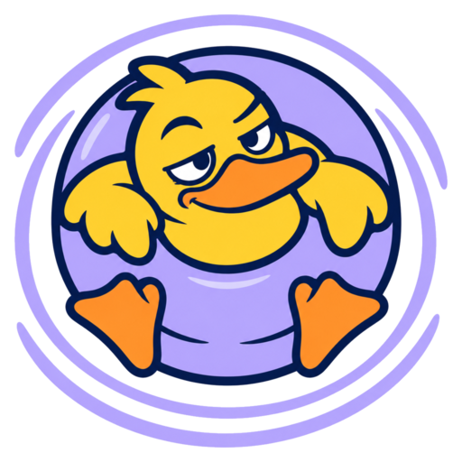
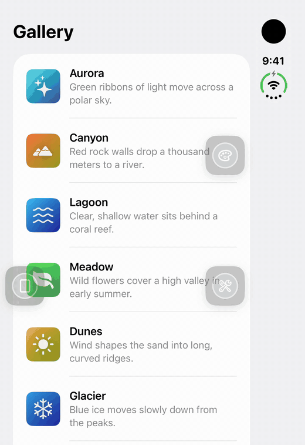
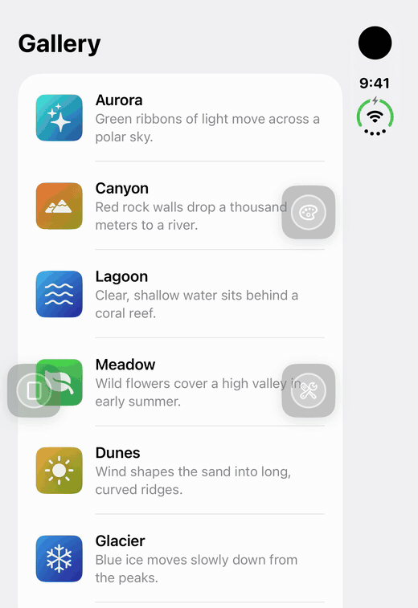
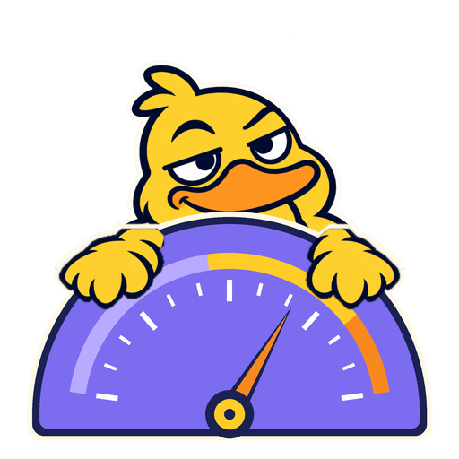
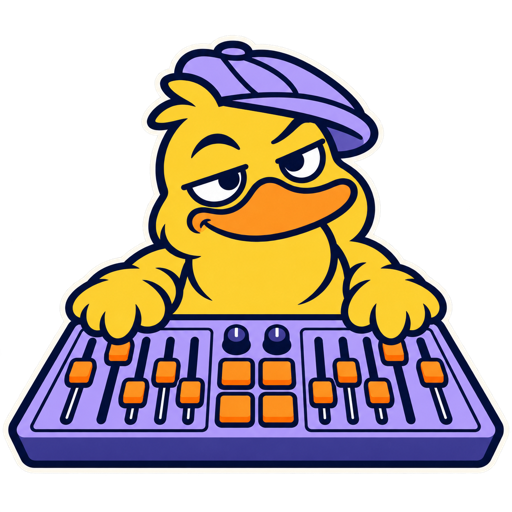

<p align="center">
  
</p>

<h1 align="center">
  <picture>
    <source media="(prefers-color-scheme: dark)" srcset="docs/wordmark-dark.svg">
    
  </picture>
</h1>

<p align="center">Floating docks for iOS layout work.</p>

DockPond has three libraries:

| Library | Use |
|---|---|
| **FloatingDock** | A floating button that docks to a screen edge and opens a panel. You supply the panel content and its actions. |
| **GaugeDock** | A layout gauge. It measures the window size, the screen, the orientation, the size classes, the safe area, the display scale, and the hinge. It can show the values in a floating dock. |
| **TweakDock** | Runtime tweaks. Declare values with macros, and change them in a debug screen while the app runs. |

Requirements: iOS 17 or later, Swift 6. The hinge values need iOS 27.1 or later.

<table>
  <tr>
    <td align="center"></td>
    <td align="center"></td>
  </tr>
  <tr>
    <td align="center"><b>FloatingDock</b>: a panel of tools</td>
    <td align="center"><b>GaugeDock</b>: layout facts</td>
  </tr>
</table>

## Install

Add the package to `Package.swift`:

```swift
.package(url: "https://github.com/yyjim/DockPond", from: "0.2.0")
```

Then add the products that you need to your target:

```swift
.product(name: "FloatingDock", package: "DockPond"),
.product(name: "GaugeDock", package: "DockPond"),
.product(name: "TweakDock", package: "DockPond"),
```

In Xcode, select **File > Add Package Dependencies**, and enter the repository URL.

## FloatingDock

The dock shows a button in a separate window above the app, also above sheets.

- Drag the button. When you release it, it moves to the nearest screen edge. The dock keeps this position after rotation, a fold, and a new launch.
- After a period without use, the button fades.
- Tap the button to open the panel. Tap outside the panel to close it. The app also receives that tap.
- Tap a panel action to close the panel and run the action.

### SwiftUI

Apply the modifier one time, to the root view of the scene:

```swift
import FloatingDock

WindowGroup {
    RootView()
        .floatingDock(title: "Tools", systemImage: "wrench.and.screwdriver") {
            ToolsView(model: model)
        } actions: {
            Button("Settings", systemImage: "slider.horizontal.3") { showsSettings = true }
        }
}
```

The panel is not in the hierarchy of your view, so it does not get your custom environment values. Give the content an observable model to read.

### UIKit

Create the controller in `scene(_:willConnectTo:options:)`, and keep a strong reference to it:

```swift
import FloatingDock

let dock = FloatingDockController(title: "Tools", contentView: toolsView)
dock.actions = [
    FloatingDockAction(title: "About", systemImage: "info.circle") { showAbout() },
]
dock.install(in: windowScene)
self.dock = dock
```

The content view must calculate its size with Auto Layout. You can also give a SwiftUI view with `FloatingDockController(title:content:)`.

### Configuration

Use `FloatingDockConfiguration` to change the dock. The dock reads it one time, when you create the dock.

| Option | Default | Use |
|---|---|---|
| `id` | `"default"` | The key for the saved button position. Give each dock its own `id`. |
| `initialEdge`, `initialPosition` | `.trailing`, `0.7` | The start position before the user moves the button. |
| `buttonSize` | `60` | The width and height of the button. |
| `idleDelay`, `idleOpacity` | 3 seconds, `0.45` | When the button fades, and how much. |
| `closesOnOutsideTap` | `true` | Closes the panel when a tap occurs outside it. |
| `windowLevel` | `.alert + 1` | The level of the dock window. |
| `tint` | `.primary` | The tint of the panel: its actions, its element controls, and the tool content. A view keeps its own tint if it sets one. |

### Tools

A panel can hold more than one tool. Each `DockTool` has a title, an icon, a view, and optional actions.

```swift
.floatingDock(title: "Dev Tools", systemImage: "wrench.and.screwdriver", panelStyle: .tabs) {
    DockTool("Controls", systemImage: "slider.horizontal.3") {
        ControlsView(model: model)
    } actions: {
        Button("Reset", systemImage: "arrow.counterclockwise") { model.reset() }
    }
    DockTool.layoutGauge(gauge)
    DockTool.appearance()
} actions: {
    Button("About", systemImage: "info.circle") { showsAbout = true }
}
```

`panelStyle` sets how the panel shows more than one tool:

| Style | Result |
|---|---|
| `.tabs` (default) | One tool at a time, with a tab for each tool. The actions of the tool show in the panel header. |
| `.sections` | All tools in one panel. Each tool has a header that collapses it. The actions of the tool show in its header. |

A panel with one tool shows no tabs and no section header.

Actions close the panel when you tap them. This applies to the actions of the dock and to the actions of a tool. Controls in a tool view do not close the panel.

Ready-made tools:

| Tool | Use |
|---|---|
| `DockTool.appearance()` | Sets the window scene to the system, light, or dark appearance. It changes all SwiftUI and UIKit windows in the scene. |
| `DockTool.layoutGauge(_:sections:)` | Shows the GaugeDock rows. It is in the GaugeDock library. Refer to [GaugeDock](#gaugedock). |

In UIKit, make a tool from a view that calculates its size with Auto Layout:

```swift
let dock = FloatingDockController(title: "Dev Tools", panelStyle: .sections, tools: [
    .layoutGauge(gauge),
    DockTool(title: "Controls", systemImage: "slider.horizontal.3", contentView: controlsView,
             actions: [FloatingDockAction(title: "Reset", systemImage: "arrow.counterclockwise") { reset() }]),
    .appearance(),
])
```

A tool that must change the window scene can read it from the `floatingDockScene` environment value.

### Element tools

Element tools change one value of the app. You do not write a view for them. The panel puts all element tools of a dock into one "General" tool. You can use element tools together with other tools in one dock.

```swift
.floatingDock(title: "Dev Tools", systemImage: "wrench.and.screwdriver") {
    DockTool.toggle("Grid", isOn: $settings.showsGrid)
    DockTool.selector("Theme", selection: $settings.theme, options: [
        "Ocean": .ocean, "Forest": .forest, "Sand": .sand,
    ])
    DockTool.stepper("Columns", value: $settings.columns, in: 1...6)
    DockTool.slider("Speed", value: $settings.speed, in: 0...2)
    DockTool.button("Reset", systemImage: "arrow.counterclockwise") { settings.reset() }
}
```

A selector with four options or fewer shows segments. A selector with more options shows a menu.

A switch uses the panel `tint` by default. Give `tint` to set its own color, for example `DockTool.toggle("Grid", isOn: $settings.showsGrid, tint: .green)`. A `FloatingDockAction` also takes a `tint`.

A switch shows at the trailing edge of its row by default. Give `alignment: .leading` to show it next to the title.

In UIKit, give closures that read and write the value:

```swift
dock.tools = [
    .toggle("Grid", get: { settings.showsGrid }, set: { settings.showsGrid = $0 }),
    .selector("Theme", options: ["Ocean", "Forest", "Sand"],
              get: { settings.themeIndex }, set: { settings.themeIndex = $0 }),
]
```

### Custom button

Add a `label` closure to show your own view in place of the default button. The closure receives a `FloatingDockButtonState` with the live state of the button:

| Property | Value |
|---|---|
| `edge` | The edge of the button. During a drag, it is the edge that the button moves to when the user releases it. |
| `isDragging` | `true` while the user drags the button. |
| `isExpanded` | `true` while the panel is open. The button fades out and becomes smaller while the panel shows. |
| `isIdle` | `true` after the button fades because nobody used it. |

```swift
.floatingDock(title: "Pool Toys", systemImage: "bird.fill") {
    DockTool("Toys", systemImage: "bird.fill") { ToysPanel() }
} label: { state in
    Image("duck")
        .resizable()
        .frame(width: 56, height: 56)
        .scaleEffect(x: state.edge == .trailing ? -1 : 1)
        .rotationEffect(.degrees(state.isDragging ? 15 : 0))
        .animation(.spring, value: state)
}
```

In UIKit, call `setButtonLabel(_:)` on the controller. Call `removeButtonLabel()` to show the default button again.

The dock keeps the drag, the edge snapping, and the tap. The label does not receive touches, and it can draw outside the button. The touch area is `buttonSize`, and it is never smaller than 44 points. VoiceOver reads the `title`. The label gets the `tint` of the configuration.

### More than one dock

You can show more than one dock at the same time. Give each dock its own `id` and its own start position, so the buttons do not start on top of each other:

```swift
RootView()
    .floatingDock(title: "Tools", configuration: FloatingDockConfiguration(id: "tools")) { ToolsView() }
    .gaugeDock(configuration: FloatingDockConfiguration(id: "gauge", initialEdge: .leading))
```

Only one panel is open at a time in each window scene. When you open a panel, the other docks close their panels. The docks do not move apart if you drag one button onto another.

UI tests can find each dock by its accessibility identifier: `FloatingDock.<id>.button` and `FloatingDock.<id>.panel`.

To show the dock in debug builds only, set `isEnabled` (SwiftUI) or `isEnabled` on the controller (UIKit) to `false` in release builds.

## GaugeDock



GaugeDock measures the layout of a window, and shows the values in a floating dock.
You can also read the values in your code.

### One line

```swift
import GaugeDock

RootView().gaugeDock()                               // SwiftUI

let gauge = LayoutGauge()                            // UIKit
gauge.attach(to: window)
let dock = FloatingDockController.gaugeDock(gauge)
dock.install(in: windowScene)
```

The dock title shows the size classes, for example "Regular · Compact". The panel shows these rows:

```
Window       951 × 669 pt · full screen
Screen       951 × 669 pt
Orientation  Landscape · right
Size class   H regular · V compact
Safe area    T 0 · L 59 · B 21 · R 59
Scale        3×
Hinge        Half Open · 92°                       ┐
Posture      Book                                  ├ only on a device with a hinge
Fold         Vertical at x 476 pt (estimated)      ┘
```

Use `sections:` to show fewer rows, for example `.gaugeDock(sections: [.window, .sizeClasses])`.

### Icon

The icon of the dock follows the orientation of the window. Give `systemImage` to set your own icon:

```swift
RootView().gaugeDock(systemImage: "ruler")                         // SwiftUI

let dock = FloatingDockController.gaugeDock(gauge, systemImage: "ruler")   // UIKit
```

To show your own view in place of the default button, add a `label` closure. It works as in [Custom button](#custom-button). When you use a label, `systemImage` shows in the panel header.

```swift
RootView().gaugeDock { state in
    Image("gauge")
        .rotationEffect(.degrees(state.isDragging ? 15 : 0))
}
```

In UIKit, call `setButtonLabel(_:)` on the controller.

### Read the values in your code

`LayoutGauge` is observable. Use `snapshot` to make your own layout decisions:

```swift
@State private var gauge = LayoutGauge()

RootView()
    .layoutGauge(gauge)
    .floatingDock(title: "My App") {
        LayoutGaugeView(gauge)
        MyRows(model: model)
    }
```

In UIKit, call `gauge.observe { snapshot in … }` and keep the returned observation.

iOS gives the hinge state and angle, but not the position of the fold on the screen. GaugeDock estimates the fold: it crosses the longer edge of the screen at its middle. The Fold row always says "estimated". Compare it with a real device before you use it for layout.

## TweakDock



TweakDock lets you change values at runtime from an in-app debug screen.
It uses ideas from [SwiftTweaks](https://github.com/bryanjclark/SwiftTweaks).

### Declare tweaks

```swift
import TweakDock

@Tweaks
enum AppTweaks {
    enum Size: String, CaseIterable, TweakValue { case small, medium, large }

    @Tweak(collection: "UI", group: "Theme", name: "Dark Mode", defaultValue: true)
    static var isDarkMode: Bool

    @Tweak(collection: "UI", group: "Font", name: "Font Size", min: 10, max: 40, defaultValue: 14)
    static var fontSize: CGFloat

    @Tweak(collection: "UI", group: "Appearance", name: "Theme", options: ["light", "dark"], defaultValue: "light")
    static var theme: String

    @Tweak(collection: "UI", group: "Appearance", name: "Size", defaultValue: Size.small)
    static var size: Size

    @Tweak(collection: "Debug", group: "Session", name: "Clear Cache")
    static func clearCache() { /* runs when you tap it */ }
}
```

### Read and write tweaks

```swift
let size = AppTweaks.fontSize
AppTweaks.fontSize = 20

AppTweaks.fontSizeTweak.publisher          // Publishes the current value, then each change.
    .sink { size in /* ... */ }
    .store(in: &cancellables)

AppTweaks.fontSizeTweak.reset()
AppTweaks.tweakStore.resetAll()
```

Each `@Tweak` adds a `<name>Tweak` peer. `@Tweaks` adds `allTweaks`, which the UI uses.

### Show the UI

```swift
// SwiftUI
.sheet(isPresented: $showsTweaks) { TweaksView(AppTweaks.allTweaks) }

// UIKit: shake the device to show the tweaks.
window = TweaksWindow(windowScene: scene, tweaks: AppTweaks.allTweaks, store: AppTweaks.tweakStore)
```

To show the tweaks without a shake, for example from a dock action, call `presentTweaks()` on the window. Give `onDismiss` to `TweaksView` to show a close button.

### Storage and app groups

`TweakStore` saves the changed values to `Application Support/TweakDock/<name>.json`.
To share tweaks with app extensions, make a store in an app group container, and give it to `@Tweaks`:

```swift
extension TweakStore {
    static let appGroup = TweakStore(appGroup: "group.com.example.app")
}

@Tweaks(store: .appGroup)
enum AppTweaks { ... }
```

Declare the store one time.

Each process reads the file when it makes the store, and again before each change.
A change keeps the changes that other processes saved.
An extension sees the changes of the app only when it makes a store or changes a tweak.

### Disable in release builds

```swift
#if !DEBUG
AppTweaks.tweakStore.isEnabled = false   // The store ignores overrides. Each tweak returns its source value or its default value.
#endif
```

### Sources: remote config and experiments

A tweak with a `sourceKey` reads its value from `TweakStore.source`.
The store finds the value in this order:

1. The override that you set in the tweaks UI or in code. The store ignores overrides when `isEnabled` is `false`.
2. The source value, when it is valid.
3. The default value.

```swift
@Tweaks
enum AppTweaks {
    enum Paywall: String, CaseIterable, TweakValue { case A, B, C }

    @Tweak(collection: "Experiments", group: "Remote", name: "Paywall", defaultValue: Paywall.A, sourceKey: "exp_paywall")
    static var paywall: Paywall
}

AppTweaks.tweakStore.source = CombinedTweakSource([
    LaunchArgumentTweakSource(),                                   // -tweak.exp_paywall B, for UI tests
    DeviceTweakSource(firebase, devices: ["exp_ipad_only": [.pad]]),
    LocalSplitTweakSource(splits: ["lab_new_badge": .rollout(0.1)]),
])

AppTweaks.paywallTweak.currentValue   // .default(.A), .source("Firebase", .B), or .override(.C)
```

The store uses a source value only when it is valid.
An unknown enum case, a value out of `min...max`, a value that is not in `options`, or text of the wrong kind gives the default value.
Use `currentValue` to report experiments to analytics:

| Case | `currentValue` | User property |
| --- | --- | --- |
| The source value is present and valid | `.source("Firebase", .B)` | `B` |
| The key is not fetched yet (first launch) | `.default(.A)` | `"default"` |
| The key is not in the source | `.default(.A)` | `"default"` |
| The value is not a known variant | `.default(.A)` | `"default"` |
| The device is not in `devices` | `.default(.A)` | `"default"` |

```swift
let userProperty = switch AppTweaks.paywallTweak.currentValue {
case .default: "default"
case let .source(_, value), let .override(value): value.rawValue
}
```

`currentValuePublisher` publishes `currentValue`, then each change.

TweakDock has these sources. None of them need a dependency.

| Source | Use |
| --- | --- |
| `CombinedTweakSource` | Asks each source in order, and uses the first value. `.source` gives the name of the inner source. |
| `DeviceTweakSource` | Gives the values of its base source only on the given devices. |
| `LocalSplitTweakSource` | Puts each device in a local bucket for an experiment or a rollout that has no server. |
| `LaunchArgumentTweakSource` | Reads `-tweak.<key> <value>` launch arguments. |
| `InMemoryTweakSource` | Keeps values in memory, for tests, previews, or a fake remote config. |

In the tweaks UI, a tweak with a `sourceKey` shows where its value comes from under its name.
To remove an override, swipe the row, or select "Use <source>" in the options.

#### Firebase Remote Config

TweakDock does not depend on Firebase. Add this adapter to your app:

```swift
import FirebaseRemoteConfig
import TweakDock

final class FirebaseTweakSource: TweakSource, @unchecked Sendable {
    let name = "Firebase"
    private let remoteConfig: RemoteConfig

    init(remoteConfig: RemoteConfig = .remoteConfig()) {
        self.remoteConfig = remoteConfig
    }

    func primitive(forKey key: String, as kind: TweakPrimitive.Kind) -> TweakPrimitive? {
        let value = remoteConfig.configValue(forKey: key)
        // `.static` means not activated yet or not in Remote Config. `.default` is a `setDefaults` value.
        guard value.source == .remote else { return nil }
        return TweakPrimitive(string: value.stringValue, as: kind)
    }
}

AppTweaks.tweakStore.source = FirebaseTweakSource()   // After FirebaseApp.configure().
```

The adapter only reads values. The app fetches and activates Remote Config, as before.
Until Remote Config activates, each sourced tweak gives its default value. After it activates, the next read gives the remote value.
Do not use `boolValue` or `numberValue`, because they return `false` or `0` for text that is not valid.
`TweakPrimitive(string:as:)` returns `nil` for that text, so the tweak uses its default value.

### Supported types

`Bool`, `Int`, `Double`, `CGFloat`, `String`, and `String`-backed `CaseIterable` enums.
To add a type, conform it to `TweakValue`.

When you open a project that uses TweakDock for the first time, Xcode asks you to trust the TweakDock macros.

## Demo

`DockPondDemo/DockPondDemo.xcodeproj` has four apps that use this package:

- **PondDemo** ("DockPond"): one app for all three libraries. Pool Party shows a FloatingDock with a custom duck button. Pool Survey shows a GaugeDock with a custom gauge button. Duck Studio shows TweakDock. A Lifeguard dock with a lifebuoy button shows on every screen.
- **SwiftUIDemo** (SwiftUI): a Dev Tools dock with tabs, a Style dock with element tools, and the gauge dock.
- **UIKitDemo** (UIKit): a Dev Tools dock with sections, and a Style dock with element tools.
- **TweakDemo**: TweakDock tweaks of each control type, and `TweaksWindow`. Its UI tests edit tweaks, check that the app updates, and check that the values stay after a relaunch.

SwiftUIDemo and UIKitDemo adapt their layout to the iPhone Duo hinge. Run them on the "iPhone Duo" simulator to see the hinge tools.

## Development

Run the unit tests of the three libraries on iOS:

```sh
xcodebuild test -scheme DockPond -destination 'platform=iOS Simulator,name=iPhone Duo' -skipMacroValidation
```

The TweakDock macro tests run only on macOS:

```sh
xcodebuild test -scheme TweakDockMacros -destination 'platform=macOS' -skipMacroValidation
```

## Licence

MIT. Refer to [LICENSE](LICENSE).
